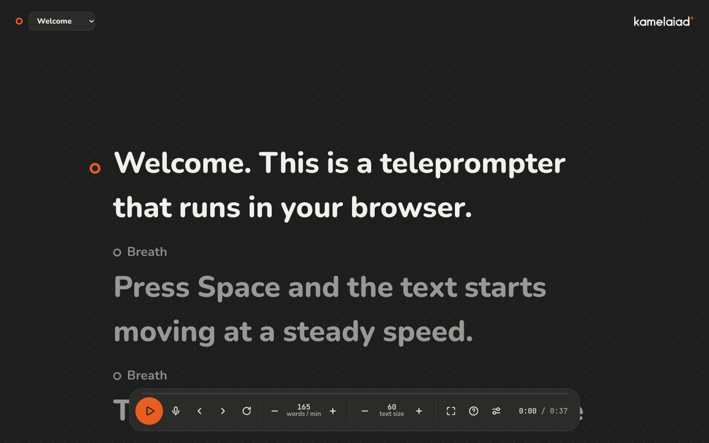

# Teleprompter

A teleprompter that runs in your browser. Paste a script, read it at a steady speed, and record your voice as you go.

**Try it:** https://kamelaiad.github.io/teleprompter/



## What it does

- **Reads at your speed.** Speed is set in words per minute and stays true at any text size.
- **Follows your pauses.** A line starting with 🟡 holds for a short breath, and a line starting with 🔴 holds for a longer stop.
- **Handles right-to-left text.** Arabic scripts read right to left, and English words inside them stay in order on one line.
- **Records your voice.** Each part saves as its own take, which you can play back or download as a WAV file.
- **Plays music in your headphones.** A track can play while you record without ending up in the take.
- **Takes your branding.** In Settings, set your own logo, brand color and background.

## Controls

| Key | Action |
|---|---|
| Space | Play or pause. While recording, it saves the part, and the next press starts a new one |
| ↑ ↓ | Faster or slower |
| ← → | Previous or next sentence |
| + − | Larger or smaller text |
| M | Ready the microphone, or stop recording |
| R | Back to the start |
| F | Full screen |
| H | Help |

## Your data

There is no account and no server. Scripts, recordings, music, your logo and your colors all stay in your own browser, so they are not shared between devices. Clearing your browser's site data removes them, so download any take you want to keep.

## Browser support

Recording was tested in Chrome. The rest of the app uses standard browser features, but other browsers have not been tested.

## Run it yourself

It is plain HTML, CSS and JavaScript, with no dependencies and no build step. Serve the folder with any static file server:

```sh
python3 -m http.server 8000
```

Then open http://localhost:8000. The microphone only works on `localhost` or over HTTPS.

## Fonts

Tajawal, Nunito and JetBrains Mono, under the SIL Open Font License. See [assets/fonts/OFL.txt](assets/fonts/OFL.txt).
